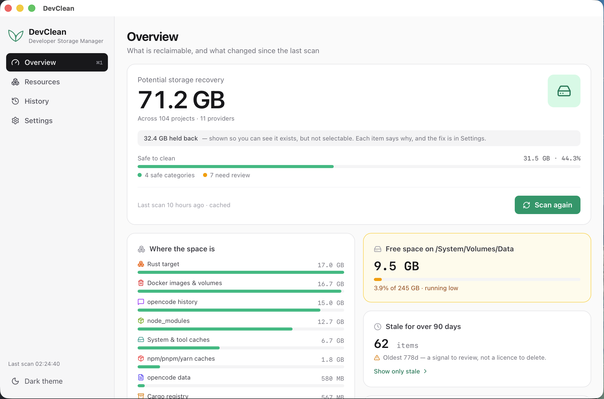
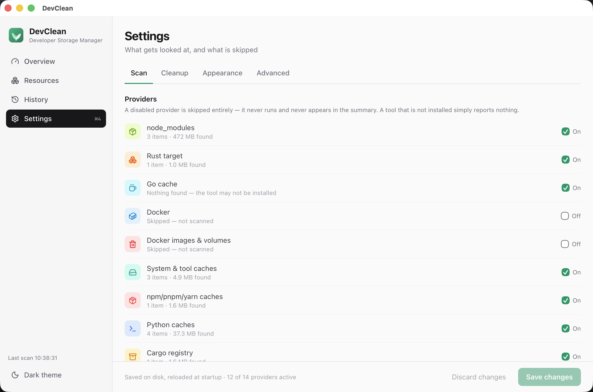

# DevClean

> **Clean the junk created by your development tools.**

DevClean monitors disk-hungry development resources (Docker build cache, `node_modules`, Go cache, Rust `target/`, …) and cleans them up safely — **diagnosis + safety + cleanup** in a single desktop app.

Stack: **Rust + Tauri 2 + Svelte 5 + Tailwind** (no React, no heavy UI kit).

[](https://github.com/arief-fajri/devclean/actions/workflows/ci.yml) [](LICENSE)



<sub>The screenshots are generated from a fixture home by [`demo/make-fixture.sh`](demo/make-fixture.sh) — realistic output, no real project names or sizes. See [docs/operations/screenshots.md](docs/operations/screenshots.md).</sub>

The fixture keeps the numbers small so the screenshots stay readable. On a real machine the totals run into the tens of gigabytes; the shape is the same.

## Install

### Download

Grab the `.dmg` from the [latest release][releases], open it, and drag DevClean to Applications.

[releases]: https://github.com/arief-fajri/devclean/releases/latest

> **First launch on macOS.** The build is not signed or notarized, so macOS refuses to open it with *"Apple cannot check it for malicious software."* That is expected. To open it once:
> - **Right-click** (or Control-click) DevClean in Applications → **Open** → **Open**, or
> - `xattr -d com.apple.quarantine /Applications/DevClean.app` Either is needed once per machine. Signing and notarization need an Apple Developer account; until then this is documented rather than hidden.

### From source

```bash
# Prereqs: Rust (pinned by rust-toolchain.toml), Node 22+, Tauri CLI 2
cargo install tauri-cli --version "^2" --locked

npm --prefix apps/desktop ci
cargo tauri build
# → target/release/bundle/dmg/*.dmg
```

### Updates

DevClean can update itself: **Settings → Updates** checks the release channel, and a newer version can be downloaded and installed without leaving the app. Every update bundle is signed with a minisign key and verified before it is installed, over HTTPS — even though the app itself is not Apple-signed. Nothing is downloaded until you press **Check for updates**; an optional "check at startup" toggle is off by default. A restart is a separate button, and installing is refused while a scan or cleanup is running.

> 0.3.0 is the first updater-enabled release: a build older than it has no updater to receive an update and must be installed by hand. From 0.3.0 on, each release arrives in-app. Updates are arm64 only.

## Development

```bash
cargo build -p devclean
npm --prefix apps/desktop ci
cargo tauri dev
```

**Your setup works if:**

- The DevClean window opens (Vite at `http://localhost:1420`)
- **Overview** shows a reclaimable total and the **Scan now** button lists 14 providers without any setup (see below)
- `cargo test --workspace` is green · `cargo clippy` has 0 warnings · `npm --prefix apps/desktop run check` has 0 errors

Full details: [docs/development/developing.md](docs/development/developing.md), and [CONTRIBUTING.md](CONTRIBUTING.md) for the rules a change has to follow.

## Platform support

| Platform | Status |
|---|---|
| **macOS** | **Tested.** The shipped build target (`app`, `dmg`), and where the full workspace runs in CI. |
| Linux | **Builds and tests; not shipped.** CI compiles the whole workspace and runs the full test suite on Ubuntu, so the Unix-specific code — allocated-block sizing, `statvfs`, `rusage`, the Trash implementation — is exercised on a second OS. No bundle is built for it and it is not supported. |
| Windows | **Not tested.** Not a build target. Path handling, Trash and block sizing are all unverified there. |

This table is enforced: `apps/desktop/src/lib/platform-claim.test.ts` fails if the README claims a platform that has no CI job, or if `tauri.conf.json` declares a bundle target for one. It exists because a support matrix drifts away from reality the moment nothing checks it.

## Repo layout

```text
devclean/
├── apps/desktop/          # Tauri app: Svelte 5 UI + thin src-tauri Rust layer
│   ├── src/               # App shell, routes, components, stores (runes), bridge
│   └── src-tauri/src/     # main.rs, commands.rs, events.rs, state.rs, tray.rs
├── crates/
│   ├── core/              # types, SafetyValidator, settings, preview tokens
│   ├── providers/         # Provider trait + 14 resource providers
│   ├── scanner/           # ScanManager (concurrent, cancellable) + cache
│   └── cleanup/           # preview + gated executor, retention, SQLite
└── docs/
    ├── architecture/overview.md
    ├── development/{developing.md, roadmap.md, methodology/{system-model.md, guardrails.md}}
    ├── reference/tauri-contract.md   # commands/events contract — never change silently
    └── security.md
```

One-way dependencies: `core ← providers ← scanner/cleanup ← src-tauri ← UI`.

## Safety

A tool that deletes files earns trust by what it refuses to do. DevClean:

- **Moves to the Trash by default.** Permanent deletion is an explicit opt-out, and a trashed item is recoverable until you empty it. The summary says what moved rather than what was freed, because the space has not come back yet.
- **Never touches your documents.** `/`, `~/Documents`, `~/Desktop`, `~/Downloads`, `~/Pictures`, `~/Videos`, `~/.ssh`, `~/.gnupg` and `~/.config` are refused from every direction — equal, inside, or ancestor.
- **Never deletes outside your scan roots.** The roots widen where caches are *found*; they never widen what may be *deleted*.
- **Refuses what it cannot explain.** Every resource that cannot be cleaned carries a reason (`retention`, `ai_read_only`, `privileged_required`, `docker_scope`, `protected`), stamped at scan time and enforced by the backend — not by a disabled checkbox.
- **Leaves AI history alone unless asked.** Session transcripts and agent state are shown with their sizes but stay unselectable until you enable them in Settings.
- **Never reports a number it did not measure.** `freed_bytes` is `before − after`; when the after-state cannot be measured, the result says `0` and why.
- **Never runs a shell.** Cleanup subprocesses use fixed `(program, args)` pairs declared by a provider, never anything derived from input.

<sub>Nothing is deleted until you acknowledge the list. Sizes are re-measured at this moment, because the numbers from the scan can go stale.</sub>

The design rationale is in [docs/security.md](docs/security.md); the reporting policy is in [SECURITY.md](SECURITY.md). A bug that deletes or moves data it should not is treated as P0.

## The window, and what is left when you close it

The app is a sidebar with four pages — **Overview** (reclaimable total, free space, biggest reclaimers, stale count, last cleanup), **Resources** (the working list), **History** and **Settings**. `⌘1`…`⌘4` switch pages, `⌘R` scans, `⌘F` focuses search.

Closing the window does not quit. DevClean stays in the **menu bar**, where one click opens a menu that answers the same questions without opening the window: how much is reclaimable, how much retention keeps, the three biggest reclaimers, the stale count, and a warning when the volume drops below 10% free. From there: Open DevClean · Scan now · Review safe items · History · Settings · Quit.

**No menu item can delete anything.** A cleanup always opens the confirmation modal in the window, with a re-measured preview — the menu bar is diagnostics and navigation only, and two guardrails enforce it ([G-UI-02](docs/development/methodology/guardrails.md), [G-UI-03](docs/development/methodology/guardrails.md)).

## Scan roots are detected, not typed

Default roots cover the usual folders (`~/Projects`, `~/Code`, `~/Workspace`, `~/Dev`, `~/Repos`, `~/Src`, `~/Work`), filtered to those that exist. **Settings → Scan → Detect folders** discovers the rest — it walks `$HOME` at most two levels deep, never descends into a cache, and reports an estimated size per candidate so you can pick without opening anything.

A `settings.json` written before this release with an empty `scan_roots` array is re-seeded from the defaults on load; otherwise the app would stay permanently blind to `node_modules` on a machine whose work lives outside the well-known folder names.

## Status

**`0.3.1` — public alpha, macOS only.** The product works end to end: it scans 14 providers, reports sizes that match `du`, cleans up recoverably, classifies project activity from git history, scans every project tree in a single pass, and can update itself in-app. What is still missing is listed in the [roadmap](docs/development/roadmap.md); what has shipped is in the [changelog](CHANGELOG.md).

Not yet done, and worth knowing before you rely on it:

- **Automatic updates are live from 0.3.0 on.** 0.3.0 already ships the updater, so a 0.3.0 install receives 0.3.1 in-app; anything older has no updater and must still be installed by hand. Updates are arm64 only. See [Updates](#updates).
- **Broad ecosystem coverage.** Ruby, Flutter, Android and LLM model stores are not scanned yet.
- **A CLI.** There is no way to run this from cron or a script.
- **Unsigned builds.** See [Install](#install).



<sub>Four tabs, and every provider can be switched off. A tool that is not installed simply reports nothing.</sub>

## Documentation

- [docs/README.md](docs/README.md) — index of everything under `docs/`
- [docs/architecture/overview.md](docs/architecture/overview.md) — how the crates fit together and which way dependencies point
- [docs/development/roadmap.md](docs/development/roadmap.md) — what is next
- [CHANGELOG.md](CHANGELOG.md) — what has shipped
- [docs/reference/tauri-contract.md](docs/reference/tauri-contract.md) — the public behaviour contract
- [CONTRIBUTING.md](CONTRIBUTING.md) — how to build, test and contribute
- [AGENTS.md](AGENTS.md) — the working agreement for automated and human contributors
